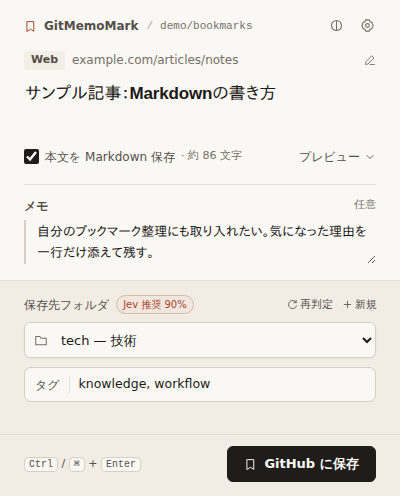
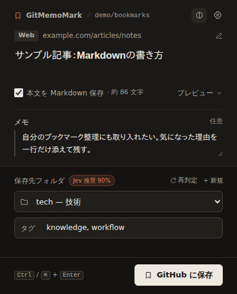

# GitMemoMark

X（旧 Twitter）のポストや Web ページを、**自分の GitHub リポジトリに Markdown として整理・保存**するデスクトップ Chrome 拡張機能（Manifest V3）です。フォルダ分け・メモ・タグ・一覧ファイル（`INDEX.md`）の更新に対応し、任意で [TypeSafe Jev](https://typesafe.ai/) によるフォルダ自動仕分けも利用できます。

[保存画面](#保存画面) · [どう保存されるか](#どう保存されるか) · [使い方](#使い方) · [導入と初期設定](#導入と初期設定) · [フォルダ管理と自動仕分け](#フォルダ管理と自動仕分け) · [プライバシーとセキュリティ](#プライバシーとセキュリティ) · [既知の制限と検証状況](#既知の制限と検証状況) · [開発とライセンス](#開発とライセンス)

> [!NOTE]
> **開発プレビュー（v0.2.0 / Chrome ウェブストア未公開）**
>
> リポジトリを取得し、Chrome に「パッケージ化されていない拡張機能」として読み込んで使います（実行に Node.js やビルド作業は不要です）。認証済み X 実アカウントでの操作や、実 API への書き込みを通した E2E テストは未実施です。データのバックアップを取り、まずは**テスト用の非公開（Private）リポジトリ**でお試しください。仕様や画面は今後変更される可能性があります。

## 保存画面

**Quiet Editorial（v0.2.0）** では、紙色のライトテーマと墨色のダークテーマを採用しています。記事タイトルと自分のメモを上段に大きく配置し、保存先フォルダやタグの整理を下段にまとめました。

以下は実際の拡張機能の保存画面です（表示されている記事・設定・仕分け結果はテスト用のサンプルデータです）。

| ライトテーマ | ダークテーマ |
| :---: | :---: |
|  |  |

- **テーマ切替**：ライト／ダーク／システム追従に対応し、設定画面または保存画面右上のボタンから切り替えられます。
- **保存前の確認と操作**：複数行タイトルの編集、本文 Markdown 保存の ON/OFF とプレビュー確認、フォルダの新規作成がその場で行えます。保存ボタンは下部に固定され、`Ctrl+Enter`（macOS は `⌘+Enter`）でも保存できます。

## どう保存されるか

保存を実行すると、指定した GitHub リポジトリへ **1 件につき 1 つの Markdown ファイル**をコミットします。既定では一覧ファイル `INDEX.md` も同じコミットで更新されます。

```text
your-bookmarks-repo/
├── INDEX.md
├── tech/
│   ├── 2026-11-01_example-com_サンプル記事-markdownの書き方_8f3a1c9e2b4d.md
│   └── x_example_1850000000000000000.md
└── _unsorted/
```

保存される `.md` ファイルには、検索や再利用がしやすいよう YAML front matter と本文が記録されます（保存画面スクリーンショットの例）。

```markdown
---
title: "サンプル記事：Markdownの書き方"
url: "https://example.com/articles/notes"
source: web
site: "example.com"
folder: "tech"
tags: ["knowledge", "workflow"]
classified_by: "jev (90%)"
saved_at: "2026-11-01T08:00:00+09:00"
---

# サンプル記事：Markdownの書き方

<https://example.com/articles/notes>

## メモ

自分のブックマーク整理にも取り入れたい。気になった理由を一行だけ添えて残す。

## 本文

（抽出した記事本文の Markdown）
```

### 保存形式とデータ保護の仕様

- **完全なオフライン保存ではありません**：Web ページの本文は同梱の Readability と Turndown で Markdown に変換しますが（本文保存は OFF にもできます）、画像や動画はバイナリを保存せず**主に元サイトの URL として記録**します。元ページ側の削除や構造によっては再現できません。
- **同一パスへの上書きは行いません**：保存先パスにすでにファイルが存在する場合、**同じ URL であっても上書きせず保存を中止**します。以前に書いたメモ・タグや GitHub 上で手作業した追記を保護するためです。既存パスに別 URL や識別不能なファイルがある場合、既存ツリーや Blob を読み取れない場合も同様に中止します。追記・更新したいときは GitHub 上で編集するか、別のフォルダに保存してください。
- **ファイル名と重複の扱い**：
  - **Web ページ**：`日付_ドメイン_タイトル_URLのSHA-1先頭12桁.md` で保存します（ハッシュはファイル名衝突の回避用であり、暗号化ではありません）。日付・タイトル・フォルダが変わると別パスになるため、別ファイルとして保存されることがあります（リポジトリ全体での URL 重複排除ではありません）。
  - **X ポスト**：`x_<handle>_<id>.md` で保存し、同じフォルダ内では日をまたいでも同じパスになります。なお X 画面からの即時保存では、保存成功後 10 分間は同一ポストの再保存をスキップする場合があります。
- **`INDEX.md` の手動追記を保持**：一覧の更新時は拡張機能が付与したマーカー付きの行だけを更新し、ユーザーが自分で書き足した行は残します（旧バージョンのマーカーなし行や旧ファイル名は自動移行しないため、初回再保存で行が重複する場合があります）。

## 使い方

普段の使い方に合わせて、設定画面で **2 つの保存モード**を切り替えられます。

- **毎回フォルダを選ぶ（既定）**：保存画面を開き、タイトル・本文プレビュー・メモ・フォルダ・タグを確認してから保存します。
- **画面を出さずにすぐ保存**：ダイアログを開かずワンクリックで保存します。保存先は「Jev で自動仕分け」または「未仕分けフォルダ（既定 `_unsorted`）にまとめて入れる」から選べます。

### 保存の呼び出し方

| 操作 | 動作 |
| --- | --- |
| **ツールバーの拡張機能アイコン** | 現在のページを保存（設定モードに従い「保存画面」または「すぐ保存」） |
| **X ポストの保存ボタン** | 各ポストに追加されるボタンで保存。**`Shift` + クリック**で設定に関わらず即時保存（ボタン表示は OFF 可） |
| **X のブックマーク操作** | 設定で連動を ON にした場合、X でブックマークしたポストを「すぐ保存」のルールで GitHub にも保存（既定 OFF、ログイン時のみ） |
| **右クリックメニュー** | ページ・選択テキスト・リンク・画像を保存。「フォルダを選ぶ」は常に保存画面、「すぐ保存」は常に即時保存 |
| **`Alt+Shift+S`** | 現在のページをダイアログなしで即時保存（`chrome://extensions/shortcuts` で変更可） |

## 導入と初期設定

### 1. Chrome への読み込み（ビルド不要）

現在のデスクトップ版 Google Chrome が必要です。拡張機能の実行に Node.js、`npm install`、ビルド手順は不要です。

```sh
git clone https://github.com/Aero123421/gitmemomark.git
cd gitmemomark
```

1. Chrome のアドレスバーで `chrome://extensions` を開き、右上の **「デベロッパーモード」** を ON にします。
2. **「パッケージ化されていない拡張機能を読み込む」** をクリックし、クローンしたフォルダ（[manifest.json](manifest.json) があるルートフォルダ）を選択します。
3. 初回導入時は設定画面が開きます。

更新するときは `git pull` を実行したあと、`chrome://extensions` で GitMemoMark の「再読み込み」を押し、開いている X のタブも再読み込みしてください。

### 2. GitHub リポジトリとトークンの設定

1. **保存先リポジトリを作成する**：GitHub でブックマーク保存用のリポジトリを用意します（**非公開 / Private を推奨**。本拡張機能のソースリポジトリとは別で構いません）。既存リポジトリを使う場合は、保存先ブランチ（既定 `main`）が存在することを確認してください。
2. **Fine-grained Personal Access Token を作成する**：[GitHub のトークン作成画面](https://github.com/settings/personal-access-tokens/new)を開き、保存先リポジトリだけに絞ったトークンを発行します。
   - **Repository access**：`Only select repositories` → **保存先リポジトリのみ**を選択
   - **Repository permissions**：`Contents` → **Read and write**（他の権限は不要）
   - **Expiration**：有効期限を設定（使わなくなったら GitHub 側で失効させてください）
3. **拡張機能の設定画面に入力する**：オーナー（ユーザー名 / Organization）、リポジトリ名、ブランチ（既定 `main`）、アクセストークン、必要に応じて保存先のルートフォルダ（空欄ならリポジトリ直下）を入力し、**「接続テスト」** 後に **「設定を保存」** を押します。

「接続テスト」はリポジトリ情報の読み取り確認であり、実際のブランチ書き込み成功までは保証しません。設定後にテスト保存を行い、コミットが作成されることを確認してください。

## フォルダ管理と自動仕分け

保存先を自動で決める場合の優先順位は **`ドメインルール` → `Jev 自動仕分け（有効時）` → `未仕分けフォルダ`** です。

### フォルダ候補とドメインルール

リポジトリに既にあるフォルダは自動で候補に読み込まれます。まだ空のフォルダを候補に出したい場合や、Jev にフォルダの用途を伝えたい場合は、設定画面の「フォルダと説明」に 1 行ずつ記述します。

```text
tech: プログラミング・技術記事
tech/ai: AI・機械学習
reading: あとで読む
```

特定のサイトを常に決まったフォルダへ入れたい場合は、「ドメインルール」に `example.org = reading` のように記述します（サブドメインにも適用され、Jev より優先されます）。

### TypeSafe Jev による自動仕分け（任意・既定 OFF）

Jev 自動仕分けは**既定で OFF** です。利用する場合は [TypeSafe console](https://console.typesafe.ai/keys) で API キーを取得して設定画面に入力し、「Jev の自動仕分けを使う」を ON にします（API 利用料が別途かかります）。

候補フォルダは深さ 3 階層まで、説明のあるフォルダを優先して最大 255 個を使用します。Choice の `confidence` が設定しきい値以上、かつ適合度（Noul）が 0.5（50%）以上の場合のみ採用し、確信度が低い場合やエラー時は未仕分けフォルダに入ります。

> [!IMPORTANT]
> **Jev を有効にした場合のデータ送信タイミングと範囲**
>
> - **保存前のポップアップ表示時にも送信されます**：Jev が ON の場合、「すぐ保存」や「再判定」時だけでなく、**保存ボタンを押す前の「保存画面を開いた時点」でも自動判定のためデータが送信される場合があります**。保存をキャンセルして画面を閉じても、送信済みのリクエストは取り消せません。
> - **既定で送信され得る項目**：タイトル、URL、サイト名、ページ説明文、選択テキスト、メモ、候補フォルダ名と説明。
> - **本文の送信は別の明示設定（既定 OFF）**：「本文も Jev に送信する」を別途 ON にした場合のみ、Web 本文や X ポスト本文の先頭 2,000 UTF-16 単位を追加で送信します（OFF でも上記メタデータや選択テキストの送信は行われます）。
> - **送信の抑止**：ドメインルールに一致した場合や、「Jev に送信しないドメイン」（サブドメインも対象）に設定したサイトでは Jev へ送信しません。詳細は [PRIVACY.md](PRIVACY.md) を参照してください。

## プライバシーとセキュリティ

- **公開リポジトリでは保存内容も公開されます**：保存すると、抽出本文・URL（クエリパラメータを含む）・選択テキスト・メモ・フォルダ名・コミットメッセージが **GitHub にコミットされます**。公開（Public）リポジトリでは誰でも閲覧でき、後からファイルを削除しても **Git の履歴やフォーク・複製に残り得ます**。非公開リポジトリの利用を推奨するとともに、著作権・サイトの利用規約・機密情報や認証後ページの扱いに注意してください。
- **トークンのローカル保管は暗号化保管庫ではありません**：設定、GitHub トークン、Jev API キーはブラウザ内の `chrome.storage.local` に保存され、Chrome Sync による同期は使いません（X の content script にも秘密情報は渡しません）。ただし、OS アカウントや Chrome プロファイル、拡張機能のデバッグ機能にアクセスできる環境から秘密を保護する**暗号化保管庫（vault）ではありません**。プロファイルの共有やデバッグ出力の公開は避け、漏洩の恐れがある場合は直ちに各サービス側でトークンを失効・再発行してください（拡張機能を削除しただけでは失効しません）。
- **独自の解析・テレメトリー送信なし**：現バージョンのソース確認では、独自のアクセス解析やテレメトリー送信は含まれていません。ただし、GitHub・TypeSafe Jev への API 通信や、閲覧サイト自身・Markdown ビューアの画像読み込み等による通信は各サービス側の処理に従います。

Chrome 権限の用途・送信データの詳細・削除手順は **[PRIVACY.md](PRIVACY.md)**、脆弱性の非公開報告窓口と注意事項は **[SECURITY.md](SECURITY.md)** を参照してください。

## 既知の制限と検証状況

- **実環境での E2E テストは未実施**：認証済み X の実アカウント操作、および実際の認証情報を使った GitHub / TypeSafe Jev への書き込み E2E テストは未実施です。同梱のモックテストはこれらを代替しません。
- **空リポジトリ初回保存の非原子性**：通常はブックマークと `INDEX.md` を 1 コミットで保存しますが、コミットがまだ存在しない空リポジトリへの初回保存のみ複数コミット（1 ファイルずつ書き込み）となるため、途中で失敗すると一部のみ作成された状態になる可能性があります。
- **X の DOM 変更と取得範囲**：X の画面構造は変化するため、ポスト・引用・メディア等の取得が不完全になる場合や、タイムライン表示で長文が省略される場合があります。保存前にプレビューを確認してください。また、過去の X ブックマークを一括エクスポートする機能はありません。
- **抽出できないページ構造**：PDF、`chrome://` 等のブラウザ内部ページ、Chrome ウェブストア、`iframe` 内の本文、ログイン壁のあるページ、閉じた Shadow DOM などは本文を取得できない場合があります。
- **本文の上限と再現性**：Web 本文の上限は 1,000〜300,000 UTF-16 単位（既定 100,000）です。上限を超える場合は開いたコードフェンスを閉じ、省略注記を含めて上限内に切り詰めます。元ページの忠実な再現は保証しません。
- **大規模ツリー・API 制限・競合**：GitHub 上のフォルダ数が非常に多い場合はフォルダ一覧が一部取得になることがあります。また API 制限、ネットワーク障害、端末をまたぐ同時保存の競合等で保存に失敗する場合があります。

## 開発とライセンス

### 開発・テスト

テストの実行には **Node.js 22 以上**が必要です。依存パッケージのインストールやビルド手順は不要です。

```sh
npm test
```

[tests/core.test.mjs](tests/core.test.mjs) は標準の `node:test` を使用した 22 件のテストスイートです。URL ハッシュによる衝突回避、入力検証、YAML／URL エスケープ、UTF-16 上限と長いコードフェンスの切り詰め、`INDEX.md` の手動追記保持、GitHub Blob 読み取り失敗時の保存中止と同一パス上書き拒否、Jev の送信範囲と除外ドメインを、ローカルの合成データとモック `fetch` で検証します（Chrome 実機や実 API は起動・通信しません）。GitHub Actions（[.github/workflows/test.yml](.github/workflows/test.yml)）は Node.js 22 / 24 を対象に設定されています。

開発手順や手動確認項目は **[CONTRIBUTING.md](CONTRIBUTING.md)**、変更履歴は **[CHANGELOG.md](CHANGELOG.md)** を参照してください。

### ライセンス

GitMemoMark のオリジナルコードとドキュメントは **[Apache-2.0](LICENSE)** ライセンスです。同梱しているサードパーティ製ライブラリ（Mozilla Readability / Turndown / turndown-plugin-gfm）には別途 Apache-2.0 または MIT の条件が適用されます。再配布時は **[THIRD_PARTY_NOTICES.md](THIRD_PARTY_NOTICES.md)** と **[NOTICE](NOTICE)** を保持してください。なお、本ライセンスは保存対象となる Web／X コンテンツの権利を付与するものではありません。
