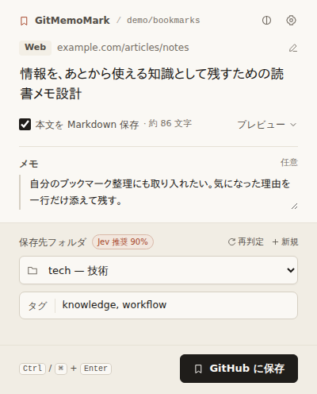
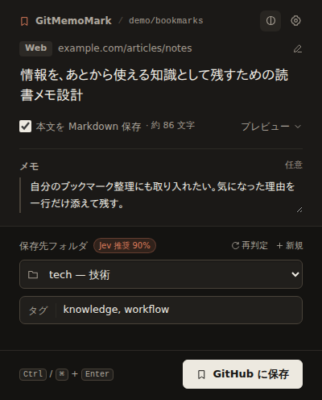

# GitMemoMark

X のポストや Web ページを、**自分の GitHub リポジトリに Markdown として保存**する Chrome 拡張機能（Manifest V3）です。任意で [TypeSafe Jev](https://typesafe.ai/) によるフォルダ仕分けを使えます。

**Developer preview / 開発プレビュー。** Chrome ウェブストア公開版ではありません。データのバックアップを取り、まずテスト用の非公開リポジトリで試してください。認証済み X と実際の認証付き API 書き込みは E2E テスト未実施です。ライト／ダーク／システム追従に対応しています。開発プレビューのため表示や設定が変わる可能性があります。

## 保存画面

**Quiet Editorial（v0.2.0）**：紙色のライトテーマと墨色のダークテーマ。記事タイトルとメモを主役にし、保存先・タグを下段にまとめた保存画面です。本文プレビュー、フォルダ、メモ、タグを確認して保存できます。

以下は実際の拡張画面です（記事・設定・仕分け結果はテスト用サンプル）。

| ライト | ダーク |
| --- | --- |
|  |  |

設定画面または保存画面右上からテーマを切り替えられます。保存ボタンは下部に固定され、長い本文やエラーは枠内でスクロールします。

## インストール

Git と現在のデスクトップ版 Chrome が必要です。拡張機能の実行に Node.js やビルドは不要です。

```sh
git clone https://github.com/Aero123421/gitmemomark.git
cd gitmemomark
```

1. Chrome で `chrome://extensions` を開き、デベロッパーモードを ON。
2. 「パッケージ化されていない拡張機能を読み込む」でクローンしたフォルダ（[manifest.json](manifest.json) がある場所）を選択。
3. 拡張機能の設定画面で GitHub を設定。更新時は `git pull` 後、拡張機能を再読み込みし、X のタブも再読み込みしてください。

## GitHub の設定

1. 保存先のリポジトリを作成（非公開を推奨）。このソースコードのリポジトリと別で構いません。
2. [Fine-grained personal access token](https://github.com/settings/personal-access-tokens/new) を作成。
   - Repository access: **Only select repositories** → 保存先のみ。
   - Repository permissions: **Contents → Read and write**。
   - 有効期限を設定し、不要になったら失効させてください。
3. オーナー、リポジトリ、ブランチ（既定 `main`）、トークン、必要なら保存先のベースパスを入力。「接続テスト」後に「設定を保存」。

接続テストは読み取り確認で、実際の書き込み成功を保証しません。既存リポジトリではブランチが存在することを確認してください。空リポジトリの初回保存は複数コミットとなることがあり、途中失敗の可能性があります。

## 使い方

| 操作 | 内容 |
| --- | --- |
| ツールバー | 現在のページを保存（フォルダ選択、または即時保存） |
| X のポストに追加される保存ボタン | そのポストを保存。Shift+クリックで即時保存 |
| X のブックマーク操作 | 設定で連動を有効にした場合、GitHub にも保存 |
| 右クリック | ページ／選択テキスト／リンク／画像を保存 |
| `Alt+Shift+S` | 現在のページを即時保存（Chrome 側で変更可） |

- **毎回フォルダを選ぶ**：タイトル・タグ・メモ、本文プレビューを確認して保存。
- **すぐ保存**：ダイアログなし。Jev 自動仕分け、または未仕分けへの保存を選択。
- 保存先の優先順位は **ドメインルール → Jev（有効時）→ 未仕分け**。
- 右クリックの「フォルダを選ぶ」は常にダイアログ、「すぐ保存」は常に即時保存。

通常のページは同梱の Readability と Turndown で本文を Markdown に変換します。本文保存は OFF にできます。画像は主に URL として保存され、画像・動画の完全なオフラインアーカイブではありません。

### フォルダと Jev（任意）

既存の GitHub フォルダに加え、設定の説明欄で候補を追加できます。

```text
tech: プログラミング・技術記事
tech/ai: AI・機械学習
reading: あとで読む
```

ドメインルール例：`example.org = reading`（サブドメインにも適用）。Jev は既定で OFF。[TypeSafe console](https://console.typesafe.ai/keys) の API キーを入力して有効にします。候補は深さ 3 階層まで、説明を優先し最大 255 個。Choice の confidence がしきい値以上、かつ Noul が 0.5 以上の場合だけ採用します。失敗・低確信度時は未仕分けになります。

**重要：Jev を有効にすると、保存ボタンを押す前のポップアップ表示時にも、タイトル・URL・サイト名・説明・選択テキスト・メモ・候補フォルダと説明が送られる場合があります。キャンセルしても送信は取り消せません。** 本文／X の本文は別の「本文も Jev に送信する」を ON にした場合のみ先頭 2,000 UTF-16 単位を追加送信します。除外ドメイン設定で送信を止められます。詳細は [PRIVACY.md](PRIVACY.md)。

## 保存形式と上書き

1 件につき Markdown 1 ファイル。URL、保存日時、フォルダ、タグなどを YAML front matter に記録し、通常は一覧の `INDEX.md` と同じコミットで保存します。

- Web のパスは日付・ドメイン・タイトル・URL の SHA-1 先頭 12 桁を含みます。ハッシュは暗号化ではありません。
- **同一の保存パスにファイルが存在すると、URL が一致していても上書きせず保存を中止します。** 以前の本文・メモ・タグや手作業の追記を保護します。更新は GitHub 上で編集するか、別フォルダに保存してください。
- 同じ URL でも日付・タイトル・フォルダが変わると別ファイルになることがあります。URL 全体での重複排除ではありません。
- X は `x_<handle>_<id>.md` で日をまたいでも同一フォルダ内では同じパス。content script の即時保存は成功後 10 分間スキップする場合があります。
- 既存パスの URL が違う、識別できない、既存 blob／ツリーを読み取れない場合は上書きを中止します。
- 一覧は生成済みの所有マーカー付き行だけを更新し、ユーザーが追加した行を残します。旧版のマーカーなし行は初回再保存で重複する場合があります。旧ファイル名も自動移行しません。

## プライバシー・権限

保存すると、抽出本文・URL・選択テキスト・メモ等が **GitHub にコミットされます**。公開リポジトリでは公開され、削除しても Git 履歴や複製に残り得ます。著作権、サイトの利用規約、機密情報に注意してください。

トークンと API キーは `chrome.storage.local` に保存（Chrome Sync は使用しません）。OS／Chrome プロファイルへのアクセスから秘密を保護する暗号化保管庫ではありません。現在のソース確認では独自の解析・テレメトリー送信は見つかっていませんが、GitHub・Jev や閲覧サイト自身のデータ処理は別です。

権限の用途・送信内容・削除手順は [PRIVACY.md](PRIVACY.md)、脆弱性の報告は [SECURITY.md](SECURITY.md) を参照してください。

## 既知の制限 / 検証範囲

- 認証済み X の実アカウント操作、GitHub／Jev の実認証付き書き込みを通した E2E テストは未実施。モックテストはこれらを代替しません。
- X の DOM は変化します。ポスト・引用・スレッドの取得が不完全な場合があります。保存前にプレビューを確認してください。
- PDF、ブラウザー内部ページ、ウェブストア、iframe 内の本文、ログイン壁、閉じた Shadow DOM 等は取得できない場合があります。
- 本文上限は 1,000〜300,000 UTF-16 単位。省略注記とコードフェンスの閉じ記号を含めて切り詰めます。忠実なページ再現は保証しません。
- GitHub の大きなフォルダ一覧は一部取得になる場合があります。API 制限・競合・ネットワーク障害で保存に失敗する場合があります。端末をまたぐ同時保存まで保証しません。

## 開発・テスト

Node.js **22 以上**（22／24 を CI 対象）で、依存パッケージのインストールは不要です。

```sh
npm test
```

[test suite](tests/core.test.mjs) は `node:test` を使用。URL 衝突、入力検証、YAML／URL、UTF-16 と長いコードフェンスの切り詰め、一覧のデータ保持、GitHub blob 読み取り失敗時の中止、Jev の送信範囲をローカルの合成データとモックで確認します。実 API や Chrome を起動しません。

開発・手動確認の手順は [CONTRIBUTING.md](CONTRIBUTING.md)。

## ライセンス

GitMemoMark のオリジナルコードとドキュメントは [Apache-2.0](LICENSE)。同梱ライブラリには別途 Apache-2.0／MIT の条件が適用されます。[THIRD_PARTY_NOTICES.md](THIRD_PARTY_NOTICES.md) と [NOTICE](NOTICE) を保持してください。保存する Web／X コンテンツの権利をこのライセンスが付与するものではありません。
